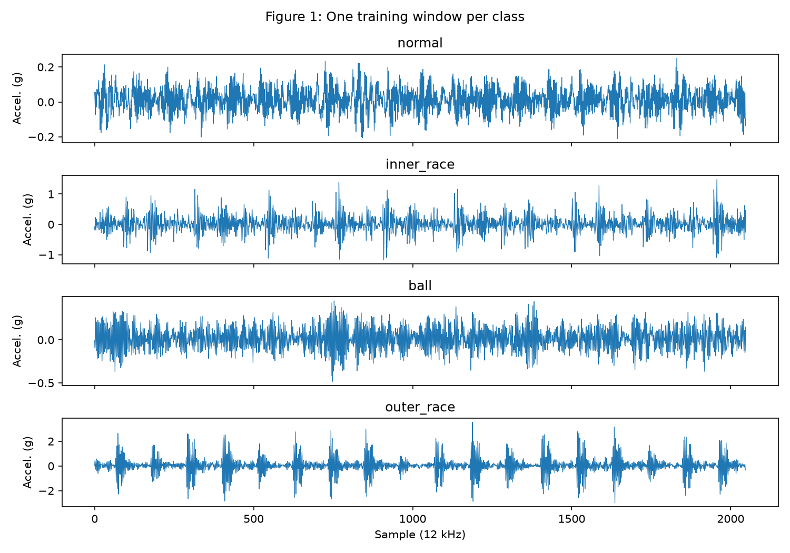
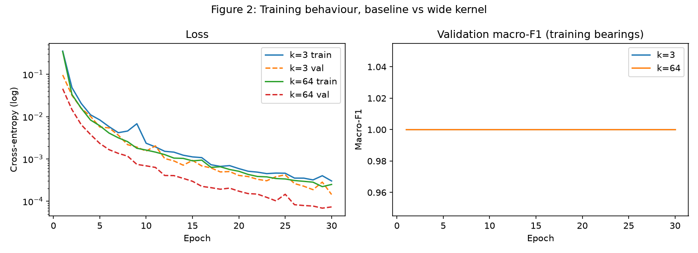
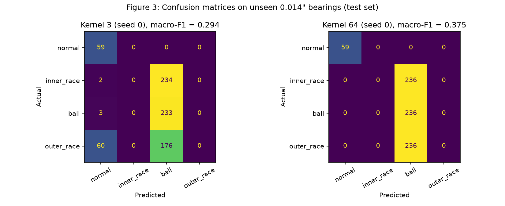
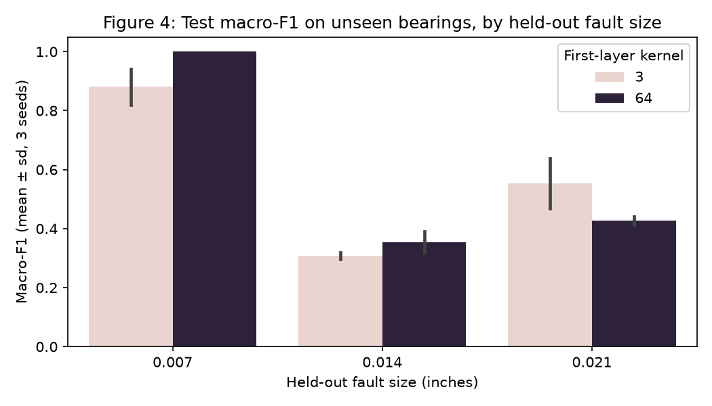

# Bearing Fault Diagnosis from Raw Vibration with a 1D CNN: Perfect on Training Bearings, Unreliable on Unseen Ones

Min Khaung Min Lwin

<!-- DRAFT. Items marked [CHECK] need verifying against the notebook or the source paper before submission. -->

## Report Overview

This project is a one-dimensional convolutional neural network (1D CNN) trained on raw vibration from the Case Western Reserve University (CWRU) bearing dataset classifies every validation window correctly, for the bearings it has never seen its macro-F1 ranges from 0.31 to 1.00, depending only on which fault size is held out. For the model, I trained a compact 1D CNN (about 21,000 parameters) to sort 2,048-sample windows into four classes (normal, inner-race, ball and outer-race fault) and tested it on bearings excluded from training. During the training proecss, I found out that widening the first convolutional kernel from 3 to 64 samples, a design proposed to improve robustness (Zhang et al., 2017), had no consistent effect. After analysing the error, this shows the network collapsing to a single class ("ball") on the hardest split, and signal amplitude explains much, but not all, of that failure.

## Dataset and Task Description

### Data

I used the CWRU Bearing Data Center's 12 kHz drive-end data (Case Western Reserve University, n.d.), which is a standard benchmark for vibration-based fault diagnosis (Smith & Randall, 2015). In the data, the faults were seeded into the test bearings by electro-discharge machining (EDM) at three diameters (0.007, 0.014 and 0.021 inches) in three locations (inner race, rolling element or "ball", and outer race at the 6 o'clock position). Each condition was recorded at four motor loads (0–3 hp, roughly 1,797–1,730 rpm). With four normal-baseline recordings, the project uses 40 files (Table 1). The task is four-class classification of fixed-length windows: normal, inner-race fault, ball fault and outer-race fault.

**Table 1**
*Files used and how they are split in the main experiment*

| Class | 0.007" | 0.014" | 0.021" | Split in main experiment |
| :--- | :--- | :--- | :--- | :--- |
| Normal | 97–100 (no fault size) | | | Train: loads 0–1; validation: load 2; test: load 3 |
| Inner race | 105–108 | 169–172 | 209–212 | 0.007" and 0.021": train loads 0–2, validation load 3; 0.014": test |
| Ball | 118–121 | 185–188 | 222–225 | as above |
| Outer race | 130–133 | 197–200 | 234–237 | as above |

*Note.* Within each group, file numbers run in load order (0, 1, 2, 3 hp).

### Data Checks Reported as Findings

Three checks changed how the data had to be handled.

1. **The normal baseline is sampled at 48 kHz, not 12 kHz.** The fault files are 12 kHz, but the normal files are about twice as long (about 244,000–485,000 samples against about 121,000). I tested the sampling rate from the spectrum. With 12 kHz assumed, the strongest low-frequency peak of normal file 97 falls at 40 Hz; with 48 kHz assumed, it falls at 30 Hz, matching the recorded shaft speed of 1,796 rpm (29.9 Hz). I therefore decimated the normal signals by 4 with an anti-aliasing filter. Without this step, the network could separate normal from faulty windows by sampling rate alone.
2. **File 99 contains two recordings.** Besides its own `X099_DE_time` channel, file 99 also stores file 98's `X098_*` channels. Code that takes the first drive-end key it finds would silently load file 98's signal twice. I select the channel whose number matches the file name.
3. **There is only one healthy bearing.** All four normal files come from the same bearing at different loads. Fault classes can be split by physical bearing, but the normal class cannot. Vieira et al. (2025) identify the same structural leak in CWRU. Normal test performance therefore measures generalisation across loads, not across bearings.

### Windowing and Splits

Each signal was cut into 2,048-sample windows (about 0.17 s, or roughly five shaft revolutions at 12 kHz). Training windows overlap by 75% (stride 512) for augmentation; validation and test windows do not overlap (stride 2,048), so no test sample is counted twice. In the main experiment this gives 4,574 training windows (349 normal, 1,406 inner race, 1,408 ball, 1,411 outer race), 414 validation windows and 767 test windows (59 normal, 236 per fault class): 5,755 in total. The leave-one-fault-size-out splits (see Experimental Comparison) contain 5,751–5,755 windows. Windows were standardised with a single mean and standard deviation computed on the training set only.

Figure 1 shows one training window per class.

**Figure 1.** *One training window per class (2,048 samples at 12 kHz).*

## Model Architecture and Design Decisions

### Architecture

The network is a four-block 1D CNN operating directly on the raw signal. Each block is a convolution, batch normalisation, a ReLU activation and max pooling:

| Block | Kernel | Channels | Pool | Output length |
| :--- | :---: | :---: | :---: | :---: |
| 1 | **3 or 64** | 1 → 16 | 4 | 512 |
| 2 | 3 | 16 → 32 | 4 | 128 |
| 3 | 3 | 32 → 64 | 4 | 32 |
| 4 | 3 | 64 → 64 | 2 | 16 |
| Head | global average pooling → dropout (0.3) → linear (64 → 4) | | | |

The model has 20,804 trainable parameters with a 3-sample first kernel and 21,780 with a 64-sample one.

### Design Decisions

- **Raw-signal input.** Convolutions over the raw time series let the network learn its own filters instead of relying on hand-designed features. This is the premise of end-to-end CNN diagnosis (Zhang et al., 2017) and keeps the comparison focused on the learned front end.
- **Batch normalisation** stabilises training and permits a single fixed learning rate across configurations (Ioffe & Szegedy, 2015).
- **Global average pooling** replaces a large fully connected layer. This keeps the parameter count small, which matters with only 12 distinct faulty bearings, and makes the classifier insensitive to where in the window an impact occurs (Lin et al., 2014). Dropout before the final layer adds further regularisation (Srivastava et al., 2014).
- **Class-weighted cross-entropy.** Normal windows make up only 8% of the training set because the normal data are a quarter as long after decimation. Each class's loss is weighted by the inverse of its frequency, so the network cannot score well by ignoring the normal class (King & Zeng, 2001).
- **Optimisation.** Adam with learning rate 10⁻³ (Kingma & Ba, 2015), batch size 64 and 30 epochs. The weights from the epoch with the lowest validation loss are kept.
- **Macro-F1 as the main metric.** The test set is imbalanced (59 normal against 236 per fault class), and accuracy can look acceptable while whole classes are missed. Macro-F1 weights each class equally.

### Why I Evaluate by Bearing

The most consequential decision is how data are split. Many CWRU studies cut each recording into windows and split the windows at random, so overlapping windows from the same bearing, and often the same recording, appear in both training and test sets. Such splits leak bearing identity and produce near-perfect, overly optimistic accuracy (Hendriks et al., 2022; Matania et al., 2024 [CHECK]; Vieira et al., 2025). Vieira et al. (2025) argue for bearing-wise splitting, in which all data from one bearing go to a single partition. In CWRU, each fault size of each fault type is a separately machined bearing, so holding out a fault size holds out the corresponding bearings. My test set therefore contains only bearings the model never saw, which is the situation a deployed monitor would face.

## Experimental Comparison

### Hypothesis

Zhang et al. (2017) proposed a wide first-layer kernel (64 samples) for raw-vibration CNNs, arguing that a wide first filter acts as a learned band-pass filter. It spans enough signal to capture the periodic impacts that a fault produces and suppresses high-frequency noise, whereas a narrow filter only sees local slopes. They reported better robustness to noise and to changes in operating conditions. **Following Zhang et al. (2017), I expected the wide kernel to generalise better to unseen bearings, giving a higher test macro-F1 than the 3-sample baseline.**

### What Changed and What Stayed Fixed

Only the first-layer kernel size changed: 3 samples (0.25 ms) against 64 samples (5.3 ms). Everything else was held fixed:

- data, windowing and training-set standardisation;
- the train, validation and test splits;
- seeds (0, 1 and 2, which control initialisation and batch order);
- optimiser (Adam), learning rate (10⁻³), epochs (30) and batch size (64);
- class-weighted loss and checkpoint selection by validation loss;
- all other layers (blocks 2–4, pooling, dropout and the linear head).

The only side effect is 976 extra parameters in the first layer (about 5% of the model). Each configuration was trained with three seeds so that a kernel effect could be told apart from run-to-run variation.

### Leave-One-Fault-Size-Out Evaluation

A single held-out fault size gives one estimate of generalisation, and that estimate might be unrepresentative. I therefore repeated the comparison three times, holding out each fault size in turn. Training used the other two sizes at loads 0–2, validation used them at load 3, and the normal data were split by load as in Table 1. This gives 3 held-out sizes × 2 kernels × 3 seeds = 18 trained models. The split that holds out 0.014" is the main experiment.

## Results and Interpretation

I first report what was observed, then my explanation and where it fails.

### Training Looks Perfect

Both configurations reach a validation macro-F1 of 1.0 from the first epoch, and validation loss keeps falling throughout training (Figure 2). On the training bearings at an unseen load, the task is trivially easy. The validation set therefore gave no warning of what happened on new bearings.

**Figure 2.** *Training and validation loss (log scale) and validation macro-F1 for kernel 3 and kernel 64 (seed 0, 0.014" held out).*

### Unseen 0.014" Bearings: Collapse to "Ball"

On the main split (0.014" held out), test accuracy is 0.381–0.385 for every run, and macro-F1 is 0.31 ± 0.01 for kernel 3 against 0.36 ± 0.04 for kernel 64. The confusion matrices (Figure 3) show what lies behind these scores. Every normal window is classified correctly, but almost every inner-race and outer-race window is labelled "ball". Per-file accuracy (kernel 64, seed 0) is 1.0 for the normal file and all four ball files, and 0.0 for all eight inner-race and outer-race files, each of which is predicted "ball". The ball class looks perfect only because "ball" is the answer for every fault. Accuracy sits at 0.385 because (59 normal + 236 ball) / 767 = 0.385. Kernel 3 scores slightly lower because it also labels about 60 outer-race windows as normal [CHECK: notebook says 60; seed-0 prediction counts imply 65 extra "normal" predictions]. In all six runs on this split, not a single window is predicted as inner or outer race.

**Figure 3.** *Confusion matrices on unseen 0.014" bearings for kernel 3 and kernel 64 (seed 0).*

### Leave-One-Fault-Size-Out: No Consistent Kernel Effect

Across all three held-out sizes (Table 2, Figure 4), performance depends far more on which size is held out (0.31 to 1.00) than on the kernel. The kernel effect also reverses direction between splits.

**Table 2**
*Test macro-F1 on unseen bearings, mean ± SD over three seeds*

| Held-out fault size | Kernel 3 | Kernel 64 | Difference (64 − 3) |
| :--- | :---: | :---: | :---: |
| 0.007" | 0.88 ± 0.06 | 1.00 ± 0.00 | +0.12 |
| 0.014" | 0.31 ± 0.01 | 0.36 ± 0.04 | +0.05 |
| 0.021" | 0.55 ± 0.09 | 0.43 ± 0.01 | −0.13 |

**Figure 4.** *Test macro-F1 by held-out fault size and first-layer kernel. Bars show the mean, and error bars the standard deviation, over three seeds.*

**The hypothesis is not supported.** The wide kernel is clearly better when 0.007" is held out, clearly worse when 0.021" is held out, and within seed variation for 0.014". A study that reported only the main split would have concluded, wrongly, that the wide kernel helps.

The collapse seen in Figure 3 is partial on the other splits. With 0.021" held out, both kernels over-predict ball (455–472 predictions for 236 true ball windows), and kernel 64 almost never predicts outer race (0–3 windows). With 0.007" held out, kernel 3 confuses inner and outer race (169–383 inner-race predictions for 236 true), while kernel 64 is perfect.

### Explanation: An Amplitude Shortcut, and Where It Fails

**Explanation.** Because standardisation uses one global scale, absolute vibration level reaches the network intact. Root-mean-square (RMS) amplitude, computed on the raw signals in the dataset's native units, differs sharply between classes and bearings:

- At 0.007" and 0.021", inner-race (0.30 and 0.48) and outer-race (0.60 and 0.57) signals have high RMS amplitude, ball signals are low (0.12–0.15), and normal is lowest (0.06).
- At 0.014", inner race (0.18) and outer race (0.10) fall into the ball range.

A network that learned "loud means race fault, moderate means ball, quiet means normal" would score perfectly on the 0.007" and 0.021" training bearings and would predict "ball" for the quiet 0.014" race faults. That is exactly the collapse I observed. It also explains why outer-race windows at 0.014", the quietest fault (RMS amplitude 0.10), are the ones occasionally labelled normal (0.06). Amplitude does not increase with fault size, so it reflects each machined bearing rather than fault type or severity. This is a textbook case of shortcut learning: a feature that is predictive in the training distribution but not causally tied to the label (Geirhos et al., 2020).

**Where the explanation fails.** The amplitude account does not explain the 0.021" split. There, the held-out outer-race bearings are loud (RMS amplitude 0.57), almost as loud as the 0.007" outer-race bearing seen in training (0.60). An amplitude-driven model should therefore label them outer race. Instead, kernel 64 assigns almost none of them to outer race (0–3 of 236 windows), and both kernels push most of them into "ball" or "inner race". So amplitude cannot be the only shortcut. The network must also rely on bearing-specific spectral or temporal features that do not transfer, and my experiments do not identify which ones. The RMS evidence is also correlational: I did not test it directly by removing amplitude information (see Future Improvements).

## Limitations and Risks

### Internal Validity

- *Validation does not predict test performance.* Validation used the training bearings at a held-out load, and scored 1.0 in every run. Model selection by validation loss therefore chose among models that were indistinguishable on validation but differed on test. A bearing-wise validation split would be more informative but would leave even fewer bearings for training.
- *Three seeds.* Standard deviations reach 0.09 macro-F1 (kernel 3, 0.021" held out). Differences below about 0.05 should not be interpreted, and some reported differences may change with more seeds.
- *Untested mechanism.* The amplitude explanation rests on a correlation between class-mean RMS and the observed errors, not on an intervention.

### Construct Validity

- *Fault size and bearing identity are confounded.* Each fault size of each type is a single physical bearing, so "unseen fault size" and "unseen bearing" cannot be separated. Vieira et al. (2025) show that the number of distinct training bearings strongly drives generalisation, and here only two bearings per fault type are available for training in each split.
- *One healthy bearing.* The normal class is never tested on a new bearing, so the perfect normal recall likely overstates how well the model would recognise a different healthy machine.
- *Small test sets for normal.* Each split has only 59 normal test windows, all from one recording.

### External Validity

- *Artificial faults.* EDM-seeded faults are clean, single-point defects. Naturally developing damage, such as spalling and wear, produces different, often weaker and more distributed signatures (Smith & Randall, 2015).
- *One test rig, one sensor position, one sampling rate.* Results may not transfer to other machines, mounting positions or noise levels.

## Ethical and Responsible Use

The main risk of this kind of model is overconfident deployment, and my own results show how it would happen. Every model I trained scored 100% on validation. An engineer who followed standard practice, splitting by recording or by load and reporting validation accuracy, would have concluded that the model was ready. On new bearings, the same models missed every inner-race and outer-race fault in the 0.014" split while reporting them as "ball" with no sign of doubt.

In industrial use, errors have unequal costs. A missed or misclassified fault can mean an unplanned shutdown, secondary damage to shafts and gearboxes and, in safety-critical settings such as rail, aviation or power generation, risk to people. A false alarm costs an inspection. A model that systematically confuses fault types also undermines maintenance planning, because inner-race, outer-race and ball faults call for different responses and progress at different rates.

Responsible use would require at least the following:

- report performance on held-out *bearings*, not held-out windows or loads, alongside any validation figure;
- state the conditions the model was tested under (fault type, artificial damage, rig, loads) and treat use outside them as unvalidated;
- keep a human analyst in the loop, with established methods such as envelope analysis as a cross-check (Randall & Antoni, 2011);
- monitor the distribution of predictions in service: a sudden dominance of one class, as in the "ball" collapse, is a detectable warning sign.

## Future Improvements

Each item below is a testable follow-up with a stated expected outcome.

1. **Break the amplitude shortcut.** Standardise each window by its own RMS, or train with random amplitude scaling. *Test:* if amplitude drives the collapse, macro-F1 on the 0.014" split should rise and the share of "ball" predictions should fall towards 25%. If it does not, other features are responsible.
2. **Envelope-spectrum input.** Replace or augment the raw signal with the squared-envelope spectrum, which isolates the fault characteristic frequencies that differ between inner race, outer race and ball by bearing geometry (Randall & Antoni, 2011). *Test:* compare leave-one-fault-size-out macro-F1 against the raw-signal model under the same protocol.
3. **Real-damage data and more bearings.** Repeat the protocol on a dataset with naturally developed damage and many distinct bearings per class, such as the Paderborn dataset (Lessmeier et al., 2016). *Test:* whether a model trained on artificial damage transfers to real damage, and how macro-F1 changes with the number of training bearings, following Vieira et al. (2025).
4. **More seeds and a formal comparison.** Use at least 10 seeds per configuration and report confidence intervals or a paired test for the kernel effect on each split.
5. **Bearing-wise validation.** Select checkpoints on a held-out bearing rather than a held-out load, and measure whether validation then predicts test performance.

Together these form the outline of a follow-up study: *Does an amplitude-invariant or envelope-based CNN generalise across bearings where a raw-signal CNN does not?*

## References

<!-- [CHECK] every entry: authors, year, volume, pages and DOI. -->

Case Western Reserve University. (n.d.). *Bearing Data Center*. Retrieved November 21, 2026, from https://engineering.case.edu/bearingdatacenter

Geirhos, R., Jacobsen, J.-H., Michaelis, C., Zemel, R., Brendel, W., Bethge, M., & Wichmann, F. A. (2020). Shortcut learning in deep neural networks. *Nature Machine Intelligence, 2*(11), 665–673. https://doi.org/10.1038/s42256-020-00257-z

Hendriks, J., Dumond, P., & Knox, D. A. (2022). Towards better benchmarking using the CWRU bearing fault dataset. *Mechanical Systems and Signal Processing, 169*, Article 108732. https://doi.org/10.1016/j.ymssp.2021.108732

Ioffe, S., & Szegedy, C. (2015). Batch normalization: Accelerating deep network training by reducing internal covariate shift. In *Proceedings of the 32nd International Conference on Machine Learning* (pp. 448–456). PMLR.

King, G., & Zeng, L. (2001). Logistic regression in rare events data. *Political Analysis, 9*(2), 137–163. https://doi.org/10.1093/oxfordjournals.pan.a004868

Kingma, D. P., & Ba, J. (2015). Adam: A method for stochastic optimization. In *3rd International Conference on Learning Representations (ICLR)*. https://arxiv.org/abs/1412.6980

Lessmeier, C., Kimotho, J. K., Zimmer, D., & Sextro, W. (2016). Condition monitoring of bearing damage in electromechanical drive systems by using motor current signals of electric motors: A benchmark data set for data-driven classification. In *Proceedings of the European Conference of the PHM Society 2016*.

Lin, M., Chen, Q., & Yan, S. (2014). Network in network. In *2nd International Conference on Learning Representations (ICLR)*. https://arxiv.org/abs/1312.4400

Matania, O., et al. (2024). [CHECK: full reference not found. I could only find this paper cited by others for the claim that data leakage is common in ML-based bearing diagnosis. If you cannot confirm it, a verified alternative is: Wheat, L., von Mohrenschildt, M., Habibi, S., & Al-Ani, D. (2024). Impact of data leakage in vibration signals used for bearing fault diagnosis. *IEEE Access*.]

Randall, R. B., & Antoni, J. (2011). Rolling element bearing diagnostics—A tutorial. *Mechanical Systems and Signal Processing, 25*(2), 485–520. https://doi.org/10.1016/j.ymssp.2010.07.017

Smith, W. A., & Randall, R. B. (2015). Rolling element bearing diagnostics using the Case Western Reserve University data: A benchmark study. *Mechanical Systems and Signal Processing, 64–65*, 100–131. https://doi.org/10.1016/j.ymssp.2015.04.021

Srivastava, N., Hinton, G., Krizhevsky, A., Sutskever, I., & Salakhutdinov, R. (2014). Dropout: A simple way to prevent neural networks from overfitting. *Journal of Machine Learning Research, 15*(56), 1929–1958.

Vieira, J. P., et al. (2025). *Towards a more realistic evaluation of machine learning models for bearing fault diagnosis* (arXiv:2509.22267) [Preprint]. arXiv. https://arxiv.org/abs/2509.22267 [CHECK: full author list; submitted to *Mechanical Systems and Signal Processing*, so cite the journal version if it has been published.]

Zhang, W., Peng, G., Li, C., Chen, Y., & Zhang, Z. (2017). A new deep learning model for fault diagnosis with good anti-noise and domain adaptation ability on raw vibration signals. *Sensors, 17*(2), Article 425. https://doi.org/10.3390/s17020425
